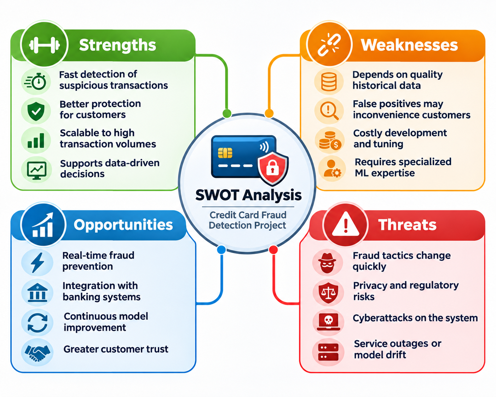
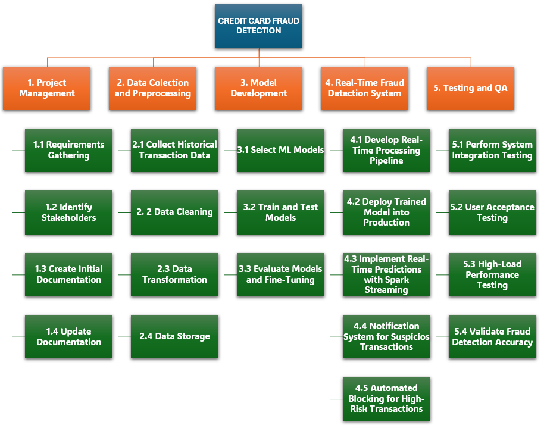
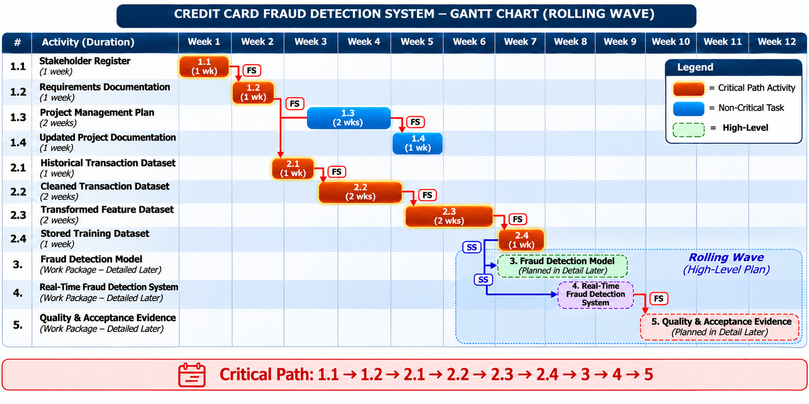

# Credit Card Fraud Detection Using Machine Learning

## Section 1. Charter Introduction

This charter provides an initial description of the proposed credit card fraud
detection project, its intended outcomes, the principal work to be undertaken,
and the deliverables expected from the project team.

### 1.1 Document Change Control

| Version | Date | Change description | Status |
| --- | --- | --- | --- |
| 0.1 | 2026-10-21 | Initial incomplete project charter draft | Draft |
| 0.2 | 2026-11-22 | Added a WBS and an RTM | Draft |
| 0.3 | 2026-11-19 | Added a Gantt Chart and Preliminary Budget | Draft |

Subsequent revisions should be recorded in this table to maintain a history of
changes to the charter.

### 1.2 Executive Summary

Credit card fraud creates substantial costs for banks through unauthorized
transactions, customer reimbursements, investigations, additional security
measures, and potential legal proceedings. Fraud can also damage a bank's
reputation by reducing customer confidence in the safety of its services.

The proposed project will develop a machine learning system to identify
potentially fraudulent credit card transactions. The team will obtain historical
transaction records containing legitimate and fraudulent examples, prepare the
data for analysis, train and evaluate supervised learning models,
and investigate
whether anomaly detection methods improve detection. The selected approach will
then be integrated into a system that evaluates incoming transactions in real
time and flags potentially fraudulent activity for further handling.

The expected business outcome is improved support for fraud detection, with the
potential to reduce financial losses and strengthen customer trust. The main
deliverables are a prepared transaction dataset, reproducible data-processing
and model-training components, an evaluation report, and a real-time transaction
scoring system. Key concerns to assess during planning include access to
suitable transaction data, privacy and security obligations, class imbalance,
and the trade-off between missed fraud and false alarms. Performance targets,
project dates, and the total cost estimate have not yet been established.

### 1.3 Authorization

The following record identifies the proposed team and the outstanding approval
required before this charter can be treated as formally authorized.

| Role | Name | Authorization or acknowledgment | Date |
| --- | --- | --- | --- |
| Project sponsor | Marcel Jar | Approved | 2026-10-21 |
| Principal Investigator | Marcel Jar | Approved | 2026-10-21 |
| Data Scientist | Tony Stark | Acknowledgment pending | TBD |
| Financial Specialist | Bruce Banner | Acknowledgment pending | TBD |

### 1.4 SWOT Analysis

## Section 2. Project Overview

The project will proceed from historical transaction data collection and
preparation through fraud-model development and evaluation to integration with
a real-time transaction assessment system.

### 2.1 Project Summary

The project's goal is to develop a system that uses machine learning to detect
potential fraud in credit card transactions. Historical records representing
both legitimate and fraudulent transactions will be collected from an
appropriately authorized source. The team will preprocess the dataset by
addressing missing values, normalizing relevant features, and managing the
imbalance between fraudulent and legitimate transactions. Apache Spark will be
used for large-scale data preprocessing.

The initial supervised learning approaches will include logistic regression and
decision trees. Models will be trained on one portion of the dataset, assessed
on held-out data, and tuned to improve predictive performance. The team will
also examine anomaly detection techniques, such as isolation forests or
one-class support vector machines, to determine whether they add value.
Implementation will use Python and relevant libraries, including pandas,
scikit-learn, and TensorFlow where appropriate.

The selected model will be incorporated into a real-time system that evaluates
incoming transactions and produces fraud-risk predictions or flags. Model
quality will be assessed using agreed performance measures that account for
both fraudulent transactions missed and legitimate transactions incorrectly
flagged. Specific acceptance thresholds, deployment arrangements, schedule,
and budget remain to be determined.

The proposed team consists of Marcel Jar (Principal Investigator), Tony Stark
(Data Scientist), and Bruce Banner (Financial Specialist).

### 2.3 Project Scope

#### 2.3.1 Work Breakdown Structure

#### 2.3.2 Requirements Traceability Matrix

| ID | Requirement | Source | Priority | Deliverable | Test Case | Status |
|---|---|---|---|---|---|---|
| R01 | Identify suspicious credit card transactions | Fraud Department | High | Fraud Detection Module | TC01 | Implemented |
| R02 | Notify analysts within 2 seconds of detection | Fraud Analysts | High | Alert Notification Service | TC02 | In Progress |
| R03 | Allow analysts to review flagged transactions | Fraud Analysts | High | Investigation Dashboard | TC03 | Implemented |
| R04 | Generate monthly fraud statistics | Bank Management | Medium | Reporting Module | TC04 | Pending |
| R05 | Restrict access to authorized personnel | Security Department | High | Access Control Module | TC05 | Verified |
| R06 | Store transaction records for future fraud investigations | Fraud Department | High | Transaction Database | TC06 | In Progress |
| R07 | Allow analysts to mark flagged transactions as fraudulent or legitimate | Fraud Analysts | Medium | Transaction Classification Module | TC07 | Pending |

### 2.4 Milestones

These are preliminary milestones in the expected sequence of work. Target dates
and formal approval gates will be confirmed during project planning.

| Milestone | Completion Event | Target Date |
|---|---|---|
| M1 - Project Authorization | Project sponsor formally authorizes the project to begin. | TBD |
| M2 - Data Access Approval | Permission to use the required credit card transaction data is granted. | TBD |
| M3 - Data Readiness Checkpoint | Project manager confirms that the data is ready for model development. | TBD |
| M4 - Model Selection Decision | Project team agrees on which machine learning model to use. | TBD |
| M5 - Testing Authorization | Project manager approves moving the system into the testing phase. | TBD |
| M6 - System Acceptance | Project sponsor confirms that the system meets the agreed requirements. | TBD |
| M7 - Project Closure | Project sponsor formally declares the project completed. | TBD |

### 2.5 Deliverables

The following proposed deliverables include both technical outputs and key
project management artifacts. Acceptance criteria are provisional and will need
to be approved during detailed planning.

| Deliverable | Description |
|---|---|
| D1 - Project Charter | Document describing the project's objectives, scope, and stakeholders. |
| D2 - Historical Transaction Dataset | Collection of historical credit card transactions for model development. |
| D3 - Data Preprocessing Scripts | Python and Apache Spark scripts for cleaning and preparing transaction data. |
| D4 - Processed Dataset | Cleaned and organized transaction data ready for machine learning. |
| D5 - Model Training Scripts | Python scripts used to train the machine learning models. |
| D6 - Model Evaluation Report | Document comparing the accuracy and performance of different models. |
| D7 - Fraud Detection Model | Trained machine learning model capable of identifying potentially fraudulent transactions. |
| D8 - Fraud Detection Prototype | Working software that receives transactions and flags potential fraud. |
| D9 - System Testing Report | Document containing the results of the system's final tests. |
| D10 - User Documentation | Instructions explaining how to install and use the fraud detection system. |

### 2.6 Project Cost Estimate

To estimate the overall project cost, we will first calculate the cost per sprint, accounting for both personnel expenses and fixed operating costs. Each sprint is assumed to have a duration of two weeks. Based on the total estimated project cost, we will then apply a **15% contingency reserve** to establish the **cost baseline**. Finally, a **20% management reserve**, calculated as a percentage of the cost baseline, will be added to determine the **total project budget**.

#### 2.6.1 Cost Per Sprint

**Personnel**
| Role | Annual Salary | Daily Rate | Allocation | Daily Burn Rate | Days (Sprint) | Sprint Burn Rate |
|---|---:|---:|---:|---:|---:|---:|
| Principal Investigator  | $150,000.00| $410.96 | 50%  | $205.48 | 14 | $2,876.71 |
| Data Scientist          | $120,000.00| $328.77 | 100% | $328.77| 14 | $4,602.74 |
| Financial Specialist    | $110,000.00| $273.97 | 100% | $273.97| 14 | $3,835.62 |
| **Total** | | | |  | | **$11,315.07** |

**Fixed Costs**
| Item | Quantity | Price | Unit Cost per Sprint| Total Cost per Sprint |
|---|---:|---:|---:|---:|
| Office Rental | 1 | $2,400/month | $1,200.00 | $1,200.00 |
| Electricity | 1 | $240/month | $120.00 | $120.00 |
| Internet Service | 1 | $120/month | $60.00 | $60.00 |
| Claude Pro Subscription | 3 | $30/month | $15.00 | $45.00 |
| Cloud GPU Computing | 2 | $800/month | $400.00 | $800.00 |
| Cloud Data Storage | 1 | $100/month | $50.00 | $50.00 |
| ML Development Software License | 2 | $480/year | $20.00 | $40.00 |
| Project Management Software | 3 | $20/month | $10.00 | $30.00 |
| Database Hosting | 1 | $160/month | $80.00 | $80.00 |
| Backup and Security Services | 1 | $80/month | $40.00 | $40.00 |
| **Total** | | | | **$2,465.00** |

---

#### 2.6.2 Overall Cost

| Item | Cost| Num Sprints | Total Cost |
|---|---:|---:|---:|
| Personnel Cost (per Sprint) | $11,315.07 | 6| $67,890.41 |
| Fixed Cost (per Sprint) | $2,465.00 | 6 | $14,790.00 |
| **Total** |  |  |  **$82,680.41** |
| Contigency Reserves (15%)| |  | $12,402.06 |
| **Cost Baseline** |  |  |  **$95,082.47** |
| Management Reserves (20%)| |  | $$19,016.49 |
| **Total Project Budget** |  |  |  **$114,098.97** |

---

### 2.7 Dependencies

The Gantt chart below illustrates the estimated durations and dependencies of the project's activities and work packages. Following a rolling wave planning approach, near-term work is planned in greater detail, while work scheduled for later stages remains at a higher level, with preliminary duration estimates that will be refined as the project progresses.

### 2.8 Project Risks, Assumptions, and Constraints

#### 2.8.1 Risks

#### 2.8.2 Assumptions

#### 2.8.3 Constraints

## Section 3. Project Organization

### 3.1 Project Governance

### 3.2 Project Team Structure

### 3.3 Roles and Responsibilities

### 3.4 Project Facilities and Resources

## Section 4. Project References

## Section 5. Glossary and Acronyms
